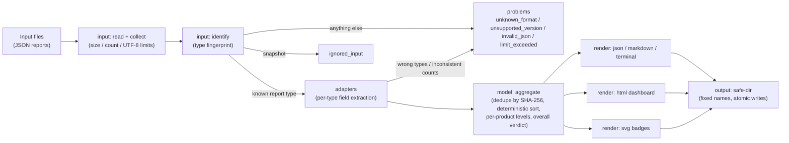

# Architecture

JOONS MCP Report Hub is a zero-dependency Node.js (>= 20, ESM) CLI and library. It only
reads JSON report files and writes its own output files: it never connects to an MCP server,
never runs a tool or any other program, makes no network request, and never sends report
data anywhere.

## Modules

| Layer | Files | Responsibility |
| --- | --- | --- |
| input | `src/input/read.js`, `src/input/collect.js`, `src/input/identify.js` | Read files with size limits, collect inputs (files or direct `*.json` children of a directory, sorted, symlinks skipped), identify the report type from a safe fingerprint of keys |
| security | `src/security/escape.js`, `src/security/redact.js` | `escapeHtml`/`escapeXml`/`escapeMarkdown`; `redactText` with fixed bounded regexes, version/timestamp validators |
| adapters | `src/adapters/*.js` (+ `index.js`) | One adapter per report type (`probe`, `diff`, `policy-gate`, `mock-server`, `contract-runner`, `validation`): read only the contract's listed fields, validate types and enums, emit the normalized report -- or a `malformed_report` problem |
| model | `src/model/normalize.js`, `src/model/aggregate.js` | Shared validation helpers (`safeCount`, `safeEnum`, ...); `buildSummary` dedupes, sorts deterministically, computes per-product levels, the test success rate and the overall verdict |
| render | `src/render/json.js`, `markdown.js`, `terminal.js`, `html.js`, `svg.js` | Renderers for the summary (JSON is the reference; Markdown and terminal must agree), the single-file dashboard, and SVG badges |
| output | `src/output/safe-dir.js` | `prepareOutputDir` enforces the output-directory safety rules; `writeFileAtomic` writes fixed names via temp file + rename |
| cli | `bin/joons-mcp-report-hub.js`, `src/cli.js`, `src/args.js`, `src/index.js`, `src/version.js` | Argument parsing (no shell, sanitized option echoes), command dispatch, exit-code contract |

`src/index.js` re-exports the public API (`VERSION`, `main`, `buildSummary`, `adaptReport`,
`identifyReport`, `collectInputs`, `parseJsonText`, `readReportFile`, `InputError`,
`redactText`, `escapeHtml`, `escapeXml`, `renderSummaryJson`, `renderSummaryMarkdown`,
`renderSummaryTerminal`, `renderDashboardHtml`, `renderBadge`, `buildBadges`).

## Data flow

1. **Collect** -- each input path becomes a list of files (a directory contributes its
   direct `*.json` children, sorted by name in code-unit order, symlinks skipped; at most
   500 files). Per-file 8 MiB and total 64 MiB limits are enforced before reading.
2. **Read & parse** -- fatal-decoding UTF-8 read (one BOM stripped), then JSON parsing with
   depth (64), node-count (500,000) and string/key (100,000 code units) limits. Parse errors
   become `invalid_json` problems carrying `line N column M` only.
3. **Identify** -- a safe fingerprint decides the report type: probe reports are recognized
   by the *absence* of a `format` key plus `schemaVersion === 1`,
   `tool.name === "joons-mcp-probe"`, and the presence of `status` and `target`; everything
   else is recognized by its `format` string. `joons-mcp-diff/snapshot` files are
   `ignored_input`; unknown formats are `unknown_format`; known formats with
   `schemaVersion !== 1` are `unsupported_version`.
4. **Adapt** -- the per-type adapter reads only the fields listed in the contract, validates
   types (wrong type -> `malformed_report` with a safe JSON-pointer path), validates enums
   against known sets (unknown tokens become `unknown`), applies per-type consistency
   checks (e.g. diff breaking-change counts, policy-gate fail/warn counts, contract-runner
   passed/failed/skipped counts) and emits the normalized report. Duplicates (identical
   SHA-256) keep the first file by sorted path order.
5. **Aggregate** -- reports are sorted by product order, report type, timestamp (null
   last) and SHA-256, then numbered `r1...rn`. Per-product levels (failure > warning > ok >
   info > none), summed counts, the test success rate
   (`FLOOR(100*passed/(passed+failed))`) and the overall verdict (FAIL -> WARN -> NO_DATA ->
   PASS, exactly as documented in the README) are computed. With `--stable`, `generatedAt`
   is null and every output is byte-identical for identical inputs, independent of input
   order and platform line endings.
6. **Render & write** -- renderers receive only the normalized summary; the allowlist was
   already applied by the adapters, so no untrusted text exists at this layer. All outputs
   go through `prepareOutputDir` + `writeFileAtomic` with fixed file names.

## Safety boundaries

- **Untrusted data stops at the adapter layer.** Adapters emit only allowlisted value
  classes (fixed vocabulary, known-set tokens, validated numbers, validated
  versions/timestamps, `report-<n>` + SHA-256 labels). Everything else is dropped;
  `--details` opts into redacted, control-stripped, 200-character-limited free text per
  finding, and `--show-file-names` opts into sanitized base names. HTML/SVG/Markdown/
  terminal renderers therefore never need to "sanitize first" -- but still escape everything
  they insert.
- **No execution, ever.** No text from an input is executed, evaluated, or used to build a
  `RegExp`, command, path or URL. Redaction uses a fixed regex set with bounded quantifiers
  (1 MB in < 200 ms).
- **Output directory rules.** `prepareOutputDir` refuses (exit 4) when the path exists and
  is not a directory, when any path component is a symlink or junction, when an input file
  lives inside the output directory, and when the directory is non-empty without the
  `.joons-report-hub-output` marker (unless `--force`; even then nothing is ever deleted).
  Only fixed names are written: `index.html`, `summary.json`, `summary.md`,
  `badges/{overall,probe,diff,policy-gate,mock-server,contract-runner}.svg`, and the
  marker.
- **Prototype pollution.** All maps derived from report data are `Map` or
  `Object.create(null)`; `__proto__`/`constructor`/`prototype` keys are never read through
  `Object.prototype`; adapters read fields with `hasOwn` + plain-object checks only.
- **Offline by construction.** The dashboard has no external resource of any kind, a CSP
  meta tag with real SHA-256 hashes of its single inline style and script, and no report
  data embedded in the script. The inline script only adds filtering and expand/collapse;
  the page works fully with scripting disabled.
